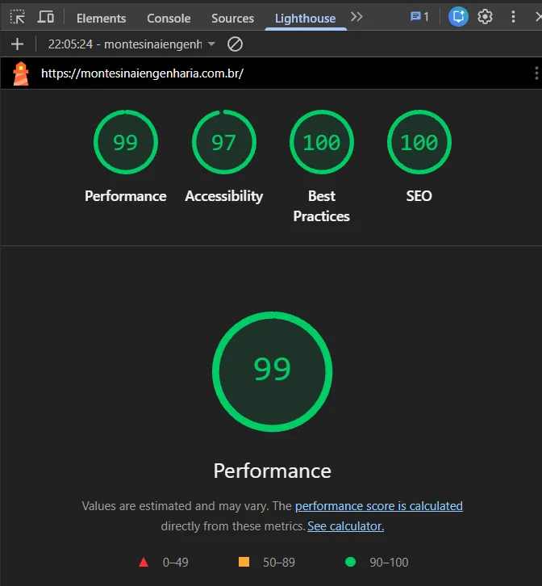
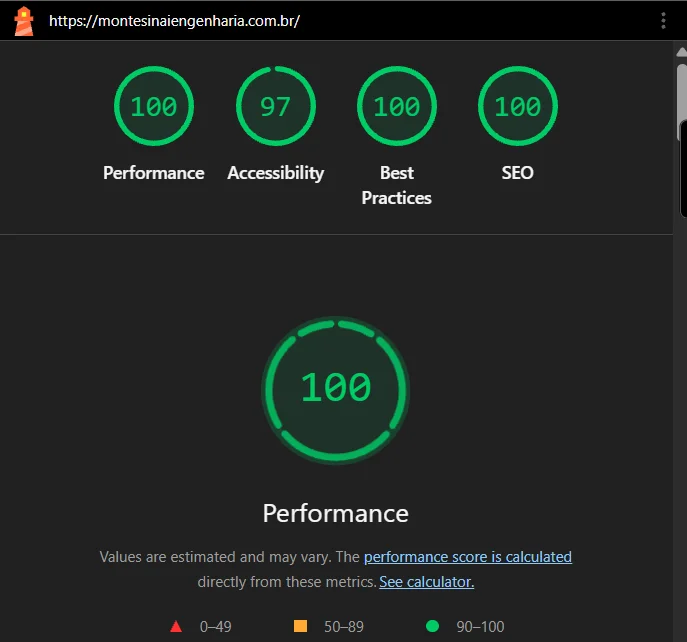

# Monte Sinai Engenharia e Construções — Site institucional

**🔗 [montesinaiengenharia.com.br](https://montesinaiengenharia.com.br)**

Site institucional da **Monte Sinai Engenharia e Construções LTDA**, empresa de engenharia elétrica sediada em Itaberaí – GO desde 2013.

Página única com apresentação da empresa, áreas de atuação, contatos por WhatsApp, mapa e formulário que envia mensagens por e-mail via SMTP.

<p align="center">
  
  
</p>

## Lighthouse

| Dispositivo | Performance | Acessibilidade | Boas práticas | SEO |
| ----------- | :---------: | :------------: | :-----------: | :-: |
| Celular     |     99      |       97       |      100      | 100 |
| Computador  |     100     |       97       |      100      | 100 |

<details>
<summary>Ver relatórios</summary>




</details>

## Stack

| Camada     | Tecnologias                                                     |
| ---------- | --------------------------------------------------------------- |
| Front-end  | React 18, TypeScript (strict), Vite, Tailwind CSS, lucide-react |
| Formulário | Endpoint PHP 8 + PHPMailer (SMTP autenticado)                   |
| Qualidade  | ESLint (incl. jsx-a11y), Prettier, Vitest + Testing Library     |
| CI         | GitHub Actions                                                  |
| Hospedagem | HostGator (Apache)                                              |

## Destaques técnicos

- **Dados centralizados** em `src/data/`: telefone, endereço, redes sociais e serviços são editados num único lugar.
- **Acessibilidade:** HTML semântico, rótulos em todos os campos, link "pular para o conteúdo", foco visível e respeito a `prefers-reduced-motion`.
- **Performance:** imagens em WebP com `srcset`, fontes auto-hospedadas (sem depender do Google Fonts) e bundle enxuto, sem bibliotecas de UI não utilizadas.
- **SEO:** meta tags e Open Graph, dados estruturados `schema.org` (Electrician), `sitemap.xml` e `robots.txt`.
- **Segurança do formulário:** validação no servidor, campo-armadilha contra robôs, limite de envios por IP e senha SMTP mantida fora do repositório e da pasta pública.

## Estrutura

```
├─ public/                 # arquivos copiados como estão para o build
│  ├─ api/enviar-contato.php
│  ├─ .htaccess            # HTTPS, cache e cabeçalhos de segurança
│  └─ robots.txt, sitemap.xml, ícones
├─ private/
│  └─ smtp-config.example.php   # modelo; o arquivo real fica só no servidor
├─ src/
│  ├─ assets/images/       # imagens otimizadas (WebP)
│  ├─ components/          # seções da página
│  ├─ data/                # dados institucionais e serviços
│  └─ lib/                 # integração com o endpoint de contato
└─ .github/workflows/ci.yml
```

## Rodando localmente

Requisitos: Node.js 20+ (veja `.nvmrc`). Para testar o envio do formulário, também PHP 8.1+ e Composer.

```sh
npm install
npm run dev          # http://localhost:8080
```

Para testar o formulário de ponta a ponta, em outro terminal:

```sh
composer install
cp private/smtp-config.example.php private/smtp-config.php   # e preencha a senha
npm run dev:php      # servidor PHP em http://localhost:8000; o Vite redireciona /api para ele
```

## Scripts

| Comando           | Descrição                            |
| ----------------- | ------------------------------------ |
| `npm run dev`     | servidor de desenvolvimento          |
| `npm run build`   | checagem de tipos + build em `dist/` |
| `npm run preview` | serve o build localmente             |
| `npm run lint`    | ESLint                               |
| `npm run format`  | formata o código com Prettier        |
| `npm test`        | testes com Vitest                    |

## Publicação (HostGator)

O deploy é automático: quando o workflow **CI** passa na `main`, o workflow **Deploy** gera o build e envia por FTPS:

| Local     | Servidor                      |
| --------- | ----------------------------- |
| `dist/`   | `public_html/` (raiz pública) |
| `vendor/` | `vendor/` (fora da raiz)      |

```
/home1/monte968/
├─ public_html/              ← build do site
├─ vendor/                   ← PHPMailer
└─ private/smtp-config.php   ← criado manualmente no servidor, nunca versionado
```

Configuração no GitHub (Settings → Secrets and variables → Actions):

| Tipo     | Nome           | Valor                                 |
| -------- | -------------- | ------------------------------------- |
| Variable | `FTP_SERVER`   | `br184.hostgator.com.br`              |
| Variable | `SITE_URL`     | `https://montesinaiengenharia.com.br` |
| Secret   | `FTP_USERNAME` | conta FTP dedicada ao deploy          |
| Secret   | `FTP_PASSWORD` | senha dessa conta                     |

O deploy também pode ser disparado manualmente em **Actions → Deploy → Run workflow**.

### Formulário de contato

O endpoint envia pelo SMTP da Locaweb, onde fica o e-mail da empresa, e lê as credenciais de `private/smtp-config.php` no servidor. Nesse arquivo ficam a conta de envio (`username`/`password`) e a lista de destinatários (`to`), mantendo endereços e senhas fora do repositório. Veja o modelo em `private/smtp-config.example.php`.

## Fluxo de trabalho

- `main` é a branch estável; mudanças entram por Pull Request a partir de branches `feat/…`, `fix/…`, `chore/…`.
- Mensagens de commit seguem [Conventional Commits](https://www.conventionalcommits.org/pt-br/).

## Direitos

Código desenvolvido por [Igor Parreira](https://github.com/igorparreirap). Marca, logotipo, textos e fotografias pertencem à Monte Sinai Engenharia e Construções LTDA. Todos os direitos reservados.
